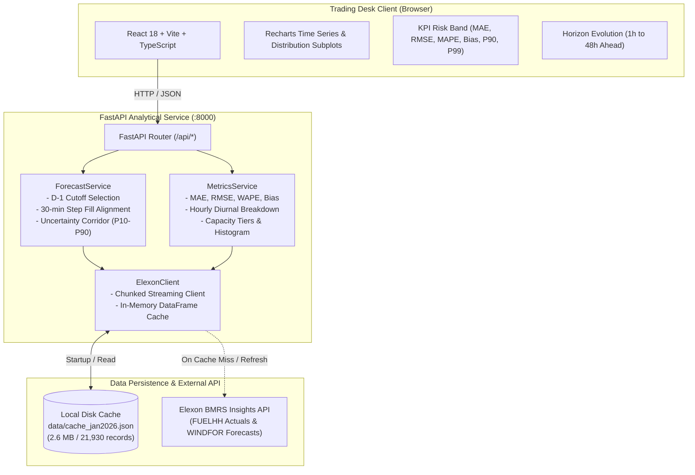

# AEOLUS | UK Wind Forecast & Accuracy Analytics

An institutional-grade full-stack web application designed for a UK energy utility's day-ahead power trading desk. AEOLUS empowers traders to evaluate the latest National Grid wind forecasts available at auction gate closure, quantify empirical forecast error distributions, and stress-test procurement exposure using uncertainty corridors.

---

## 1. Business Context & Trading Rationale

In the Great Britain (GB) electricity market, wholesale power for delivery on day **$D$** is actively procured on day-ahead power exchanges (**EPEX SPOT GB** and **Nord Pool GB**). 

* **Auction Timelines:** The Day-Ahead auction order books close at **11:00 GMT**, with market clearing results published by **12:00 GMT on day $D-1$**.
* **Decision Gate (Cutoff):** At auction submission, power traders must determine how much conventional thermal, hydro, or imported power to purchase to cover expected consumer demand net of renewable generation (*residual demand*). To do so, they rely on the National Grid wind forecasts available **prior to the $D-1$ cutoff** (default: **12:00 GMT on $D-1$**).
* **Imbalance Cashout Exposure (BSC Section T):** Any deviation between contracted positions and physical delivery incurs cashout charges at the **System Price**:
  * **Over-forecasting (Positive Bias):** The desk procures less wholesale power expecting abundant wind. When wind under-delivers, the utility is left **short** and must settle the deficit at volatile System Buy Prices.
  * **Under-forecasting (Negative Bias):** The desk over-buys wholesale power. When wind over-delivers, the utility is left **long**, spilling energy at depressed System Sell Prices.
* **Objective of AEOLUS:** Provide an uncompromised historical view of forecasts available at decision time throughout **January 2026**, quantify forecast errors across hours and horizons, and superimpose historical uncertainty envelopes ($P_{10} - P_{90}$) so traders can size their reserves.

---

## 2. Architecture & Technical Design

AEOLUS is built as a decoupled, high-performance web system with a reactive TypeScript frontend, an asynchronous Python FastAPI analytical engine, and a dual-layer caching architecture.



### Component Breakdown
1. **Frontend (`frontend/`):** React 18, TypeScript, TailwindCSS, and Recharts. Engineered with a crisp, institutional light trading desk theme.
2. **Backend Engine (`backend/`):** FastAPI application with vectorized pandas / numpy numerical processing, Pydantic v2 data validation, and async HTTP streaming (`httpx`).
3. **Data Cache (`backend/data/cache_jan2026.json`):** Pre-warmed serialized JSON store containing all 1,490 half-hourly wind actuals and 20,440 wind forecasts for January 2026 (including late December 2025 runs). Boots the service in **<35 milliseconds** with zero rate-limit exposure.
4. **Vercel Services Architecture (`vercel.json`):** Multi-service configuration routing `/api/*` to the FastAPI backend service and `/*` to the Vite React frontend.

---

## 3. Data Specification & Domain Assumptions

### Data Streams (Elexon BMRS)
* **Actual Wind Generation (`FUELHH`):**
  * Endpoint: `https://data.elexon.co.uk/bmrs/api/v1/datasets/FUELHH/stream`
  * Filter: `fuelType == "WIND"`.
  * Granularity: **30-minute settlement periods (48 periods/day)**.
  * Fields: `startTime`, `settlementDate`, `settlementPeriod`, `generation` (MW).
* **Wind Generation Forecasts (`WINDFOR`):**
  * Endpoint: `https://data.elexon.co.uk/bmrs/api/v1/datasets/WINDFOR/stream`
  * Granularity: **Hourly (`:00` minutes)**, projecting 72–84 hours into the future, published every 2–4 hours.
  * Fields: `startTime`, `publishTime`, `generation` (MW).

### Core Domain Logic & Assumptions
1. **Day-Ahead Decision Time Cutoff:**
   For any target delivery timestamp $T$ occurring on delivery day $D$, the auction cutoff is defined as:
   $$\text{Cutoff}(D) = (D - 1\text{ day}) \text{ at } H_{\text{cutoff}} \text{ (default 12:00 GMT)}$$
   The selected forecast $\hat{y}_T$ is the most recent forecast published before this cutoff:
   $$\hat{y}_T = \operatorname*{argmax}_{\text{publishTime} \le \text{Cutoff}(D)} (\text{publishTime})$$
   *Adjustment:* The cutoff is completely user-configurable via the header dropdown (e.g., 09:00, 11:00, 12:00, 14:00, 17:00 GMT) to allow desks to simulate earlier internal trade deadlines or later gate closures.
2. **Resolution Alignment (30-Minute vs. 60-Minute):**
   * *Domain standard:* In UK power trading, hourly forecasts represent the expected average generation across the entire clock hour. To match the 48 half-hour settlement periods, AEOLUS applies a **step forward-fill** mapping (the forecast for hour $HH:00$ applies to both settlement period $2HH+1$ at $:00$ and $2HH+2$ at $:30$).
   * *Hourly View:* Users can toggle the resolution to **1-Hour**, in which case the two 30-minute actuals are averaged ($A_{H} = \frac{A_{H:00} + A_{H:30}}{2}$) for direct hourly comparison.
3. **Timezones:**
   In January, Great Britain observes **Greenwich Mean Time (GMT = UTC+0)**. No British Summer Time (BST) offsets exist. Timestamps are stored and processed in UTC and displayed in UK Local Time (GMT).
4. **Boundary Fetching:**
   To evaluate forecasts targeting January 1, 2026 at the D-1 12:00 cutoff, the WINDFOR query window was extended back to **December 28, 2025**.

---

## 4. Quantitative Metrics & Formulas

| Metric | Formula | Business Interpretation for Trading Desk |
| :--- | :--- | :--- |
| **MAE** | $\frac{1}{N}\sum \|F_i - A_i\|$ | Mean volume error magnitude in MW. Dictates average balancing requirement. |
| **RMSE** | $\sqrt{\frac{1}{N}\sum (F_i - A_i)^2}$ | Root mean squared error in MW. Heavily penalizes large tail forecast misses. |
| **MAPE (Guarded)** | $\frac{1}{N}\sum \frac{\|F_i - A_i\|}{\max(A_i, \epsilon)} \times 100\%$ | Percentage error. Guarded against division-by-zero using $\epsilon = 1.0\text{ MW}$. |
| **WAPE** | $\frac{\sum \|F_i - A_i\|}{\sum A_i} \times 100\%$ | Weighted percentage error. Immune to low-wind percentage distortion. |
| **Systemic Bias** | $\frac{1}{N}\sum (F_i - A_i)$ | Positive ($+$) = Over-forecasting (Short risk). Negative ($-$) = Under-forecasting (Long risk). |
| **P90 Tail Error** | $\text{Percentile}_{90}(\|F - A\|)$ | 90% of periods experience volume errors below this threshold. |
| **P99 Peak Risk** | $\text{Percentile}_{99}(\|F - A\|)$ | 1-in-100 extreme stress-scenario volume error for capital adequacy. |
| **Uncertainty Corridor** | $[F_t + Q_{10}(A - F), F_t + Q_{90}(A - F)]$ | 80% empirical prediction interval around the forecast to visualize procurement risk. |

---

## 5. Local Setup & Execution

### Prerequisites
* Python 3.9+ (Python 3.11 / 3.12 / 3.14 supported)
* Node.js 18+ and npm
* (Optional) Docker & Docker Compose

### Fast Start (Local Unified Dev)
1. **Clone the repository:**
   ```bash
   git clone https://github.com/npcenergydev/AEOLUS.git
   cd AEOLUS
   ```

2. **Set up Python Virtual Environment:**
   ```bash
   python3 -m venv .venv
   source .venv/bin/activate
   pip install -r backend/requirements.txt
   ```

3. **Install Frontend Dependencies & Build:**
   ```bash
   cd frontend
   npm install
   npm run build
   cd ..
   ```

4. **Launch Application:**
   ```bash
   PYTHONPATH=. uvicorn backend.app.main:app --host 127.0.0.1 --port 8000
   ```
   Open **`http://localhost:8000`** in your browser. The single FastAPI process serves both the interactive React frontend and all API endpoints.

5. **Run the Pytest Suite:**
   ```bash
   PYTHONPATH=. pytest backend/tests/ -v
   ```
   All 20 unit and integration tests will execute in <1 second.

---

## 6. Docker Containerization

AEOLUS provides a production-grade multi-stage `Dockerfile` and `docker-compose.yml` for zero-configuration container execution.

### Single-Command Run:
```bash
docker compose up --build
```

* **Stage 1 (`frontend-builder`):** Compiles the React + TypeScript frontend into minified production assets using Node.js Alpine.
* **Stage 2 (`runtime`):** Minimal Python 3.11-slim container running Uvicorn with auto-healing Docker health checks (`/api/health`).
* **Access:** Open **`http://localhost:8000`**.

---

## 7. Deployment to Vercel

AEOLUS is configured for **Vercel Services** (multi-service monorepos), allowing the Vite React frontend and the Python FastAPI backend to deploy together within a single Vercel project under the same domain.

### Vercel Deployment Steps:
1. **Push to GitHub:**
   Connect the repository to Vercel via the Vercel Dashboard (`vercel.com/new`).
2. **Automatic Detection:**
   Vercel automatically detects the multi-service layout from `vercel.json`:
   * **`frontend` service:** Framework `vite`, root `frontend/`.
   * **`backend` service:** Framework `fastapi`, root `backend/`.
3. **Deploy:**
   Click **Deploy**. Vercel builds both services concurrently.

### How Vercel Routing Works (`vercel.json`):
* `/api/(.*)` requests are transparently routed to the `backend` FastAPI service.
* All other requests (`/(.*)`) route to the `frontend` Vite single-page app.
* The pre-cached data file (`backend/data/cache_jan2026.json`) is included directly inside the backend service bundle, ensuring instant sub-50ms cold starts without external API latency.

---

## 8. Limitations & Future Roadmap

1. **National vs. BMU-Level Granularity:** AEOLUS currently operates on the national transmission system wind aggregate (`FUELHH` WIND and `WINDFOR`). Future versions can integrate individual Balancing Mechanism Unit (BMU) wind farm metering (`B1610` / `B1630` streams) to isolate zonal export constraints in Scotland vs. England.
2. **Residual Demand Procurement:** Actual demand forecasting (`DEMFOR` stream) can be overlaid to directly calculate residual thermal procurement envelopes.
3. **Continuous Intraday Horizon Triggers:** Future iterations can trigger simulated automated buy/sell orders in the intraday continuous market (EPEX Intraday Continuous / Nord Pool Elbas) as forecast revisions cross pre-set risk thresholds.

---

## 9. AI Tools Disclosure

In accordance with engineering transparency requirements, this project was architected, engineered, tested, and documented using **Gemini / Google DeepMind Antigravity** as an AI pair programmer. AI tools were utilized for:
* Elexon BMRS API exploration and parameter validation.
* Vectorized numerical metric pipelines (MAE, RMSE, WAPE, quantiles).
* Pytest unit and integration test generation.
* Recharts trading desk interface construction with Tailwind CSS.
